# Guía de Usuario

**Sistema Integrado de Gestión — Junta de Agua y Riego La Jones (Patate)**

- Versión del sistema: `v1.3.2`
- Fecha de la guía: 13 de noviembre de 2026
- Destinatarios: socios y socias de la Junta, y la directiva

---

## Contenido

1. Información general
2. Objetivo y alcance de esta guía
3. Requisitos para usar el sistema
4. Acceso al sistema e inicio de sesión
5. La pantalla y la navegación
6. Portal público
7. Instrucciones para socios y socias (rol Usuario)
8. Instrucciones para la directiva (rol Administrador)
9. Formularios y validaciones
10. Mensajes del sistema
11. Solución de problemas frecuentes
12. Preguntas frecuentes
13. Recomendaciones de uso
14. Glosario
15. Limitaciones conocidas

---

## 1. Información general

El sistema es la plataforma web de la Junta de Agua y Riego La Jones. Reúne en un solo lugar:

- el padrón de socios y el catastro de lotes (terrenos) con su ubicación en el mapa;
- los turnos semanales de riego;
- las asambleas y mingas: convocatorias, asistencia, actas y multas por ausencia;
- el cobro del pago anual de agua (por hectárea) y de las multas, con recibos;
- los egresos, el inventario, el plan anual y las noticias de la Junta.

Hay tres formas de usarlo:

| Quién | Qué ve |
|---|---|
| Cualquier persona, sin iniciar sesión | El portal público: inicio, cronograma de turnos, comunicaciones y noticias |
| Socio o socia con cuenta (**Usuario**) | Además, "Mi cuenta": sus deudas, sus pagos y sus lotes |
| Directiva (**Administrador**) | Además, el panel de **Gestión** para administrar todo el sistema |

## 2. Objetivo y alcance de esta guía

Esta guía explica, paso a paso, cómo usar cada función que el sistema tiene hoy. Solo describe lo que existe y se comprobó; lo que no tiene pantalla se indica en la sección 15 y en [`OBSERVACIONES.md`](OBSERVACIONES.md).

Las imágenes son capturas reales del sistema tomadas con **datos de prueba**: los nombres, cédulas y montos son ficticios.

## 3. Requisitos para usar el sistema

- Un computador, tableta o teléfono con conexión a internet.
- Un navegador actualizado (Chrome, Edge, Firefox o Safari).
- Para entrar a "Mi cuenta" o al panel de Gestión: una **cuenta** creada por la directiva y su **cédula** y **contraseña**.
- Para la verificación en dos pasos (opcional, directiva): una aplicación de autenticación en el teléfono, como Google Authenticator, Microsoft Authenticator o Authy.

## 4. Acceso al sistema e inicio de sesión

### Entrar al sistema

**Objetivo:** ingresar con su cuenta.

**Permisos necesarios:** tener cuenta (Usuario o Administrador).

**Procedimiento:**

1. Abra la dirección del sistema en su navegador.
2. Pulse **Iniciar Sesión**, arriba a la derecha.
3. En **Cédula**, escriba su número de cédula (10 dígitos, sin espacios ni guiones).
4. En **Contraseña**, escriba su contraseña. El ícono del ojo la muestra u oculta.
5. Deje marcado **Recordar mi sesión** si usa su propio equipo; desmárquelo en un equipo compartido.
6. Pulse **Ingresar al Sistema**.

**Resultado:** la directiva entra al panel de **Gestión**; los socios, a **Mi cuenta**.

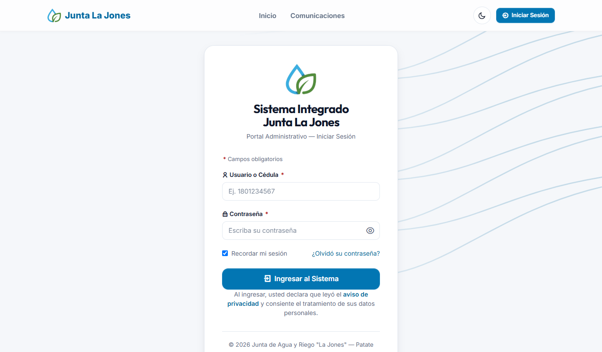

**Consideraciones:**

- Se ingresa solo con la cédula: no existen nombres de usuario. Si escribe otra cosa, el sistema pide "Ingrese su número de cédula de 10 dígitos".
- Si escribe mal la contraseña, el mensaje es siempre el mismo: "Credenciales incorrectas o la cuenta no está habilitada o se encuentra bloqueada temporalmente."
- Tras **5 intentos fallidos en 15 minutos**, la cuenta queda bloqueada **15 minutos desde ese equipo o red**. Desde otra red puede seguir entrando. La directiva puede desbloquearla antes (sección 8.2).
- "Recordar mi sesión" mantiene la sesión abierta hasta 8 horas aunque cierre el navegador.

### Primer ingreso: cambiar la contraseña temporal

**Objetivo:** reemplazar la contraseña temporal que le entregó la directiva.

**Procedimiento:**

1. Ingrese con su cédula y la contraseña temporal.
2. El sistema muestra el formulario de cambio. Escriba la contraseña nueva dos veces.
3. Pulse **Cambiar Contraseña**.

**Resultado:** el mensaje "Contraseña actualizada. Redirigiendo..." y la entrada a su pantalla.

**Consideraciones:** la contraseña nueva debe tener **al menos 10 caracteres**, combinar **letras y números**, no contener su cédula y no ser demasiado común (por ejemplo, "Junta2026" o "password123" se rechazan). Con **Cancelar y salir** vuelve al inicio sin cambiarla.

### Segundo paso: código de verificación (solo si lo activó)

Si un administrador activó la verificación en dos pasos (sección 8.9), después de la contraseña el sistema pide el **Código de verificación**:

1. Abra la aplicación de autenticación en su teléfono.
2. Escriba el código de 6 dígitos que muestra para "Junta La Jones".
3. Pulse **Verificar código**.

Si perdió el teléfono, escriba uno de sus **códigos de recuperación** (formato `ABCDE-FGHIJ`); cada uno sirve una sola vez. **Volver** regresa al formulario de cédula y contraseña.

### ¿Olvidó su contraseña?

El botón **¿Olvidó su contraseña?** explica el procedimiento: acérquese a la secretaría de la Junta o comuníquese con la directiva. Por seguridad, la contraseña temporal nueva se entrega en persona.

### Cerrar sesión

Pulse **Cerrar Sesión**, arriba a la derecha. La sesión se cierra en ese equipo **y en todos los demás** donde estuviera abierta.

## 5. La pantalla y la navegación

- **Barra superior:** logotipo (vuelve al inicio), **Inicio**, **Comunicaciones**, y según el rol **Mi cuenta** o **Gestión**. A la derecha, el botón del sol o la luna cambia entre modo claro y oscuro, y el botón de sesión.
- **Panel de Gestión (directiva):** un menú lateral con **Resumen general**, **Gestión de Usuarios**, **Convocatorias**, **Turnos de agua**; el grupo **Finanzas** (**Cobros y pagos**, **Tarifas y pago anual**, **Historial financiero**); el grupo **Directiva** (**Gestión interna**, **Noticias**); y **WhatsApp Web**. Debajo, el indicador "Sistema en línea".
- **Pestañas:** varias secciones tienen pestañas, por ejemplo **Padrón** y **Catastro de lotes**, o **Cobrar** y **Egresos**.
- **Avisos:** las confirmaciones aparecen en una notificación en la esquina superior derecha que se cierra sola.
- **Teléfono:** en pantallas pequeñas el menú se abre con el botón de las tres líneas y las tablas se muestran como tarjetas.

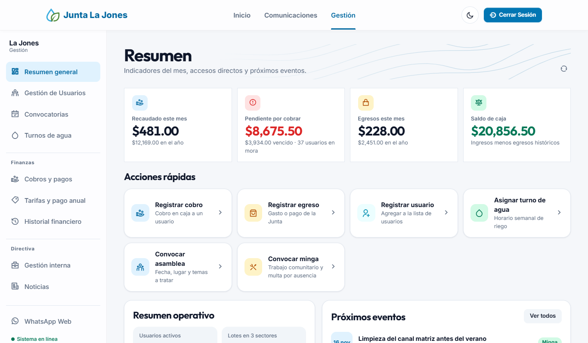

## 6. Portal público

### Página de inicio

Presenta a la Junta: quiénes somos, misión, sectores, directiva, contacto, las últimas noticias en un carrusel y las próximas mingas y asambleas.

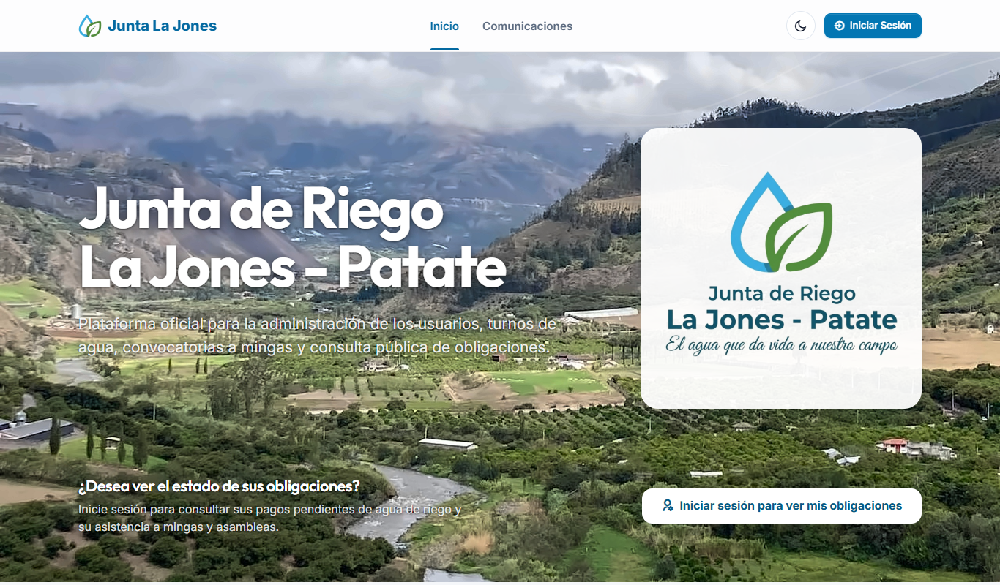

### Consultar el cronograma de turnos de riego

1. En la página de inicio, pulse **Ver cronograma de riego**.
2. Elija el sector y, si quiere, el día.
3. Cambie entre **Tarjetas** y la planilla.
4. Para imprimir, use **Imprimir Hoja** o **Planilla Oficial (Formato PDF)**.

El cronograma público muestra el lote y el horario, **no** el nombre ni la cédula de las personas.

### Comunicaciones (asambleas y mingas)

1. Pulse **Comunicaciones** en la barra superior.
2. Elija la pestaña **Asambleas** o **Mingas**.
3. Filtre por **Todas**, **Ordinarias** o **Extraordinarias**, y por **Sector**.
4. En cada evento puede abrir la convocatoria oficial en PDF.
5. **Ver Acta Firmada** abre el acta escaneada; para verla debe haber iniciado sesión.

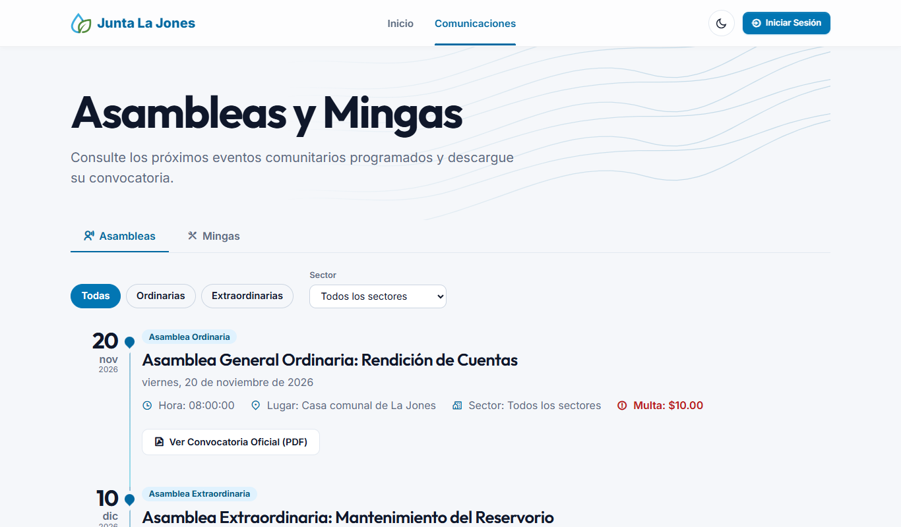

### Noticias

En **Todas las noticias** puede buscar por texto, filtrar por etiqueta y por fechas de publicación, y abrir cada noticia.

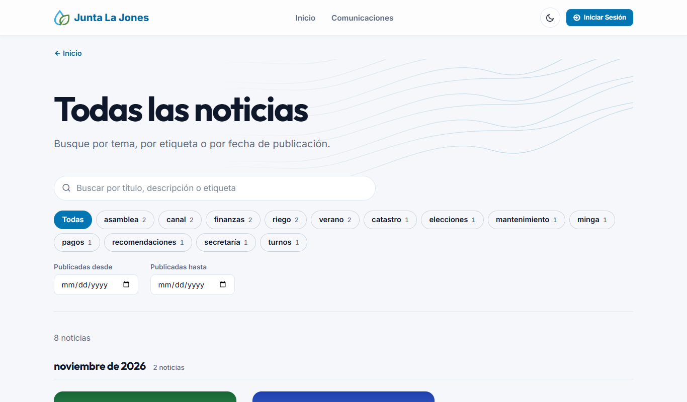

### Aviso de privacidad

El enlace **Aviso de privacidad** (pie de página y pantalla de ingreso) explica qué datos personales trata la Junta y para qué.

## 7. Instrucciones para socios y socias (rol Usuario)

### Consultar mis deudas y pagos

**Objetivo:** saber cuánto debe y qué pagó.

**Procedimiento:**

1. Inicie sesión. El sistema abre **Mi cuenta**.
2. Arriba ve su nombre, cédula, lotes y el **Total que debe pagar**, con el estado **VALORES PENDIENTES** o **AL DÍA EN PAGOS**.
3. En **Obligaciones Pendientes** ve cada valor: pago anual de agua por lote y multas.
4. En **Comprobantes de Pago Realizados** ve sus recibos; puede **imprimirlos**, **descargarlos en PDF** y, si la directiva adjuntó la transferencia o el depósito, descargar el **Respaldo**.
5. En **Historial de Cuentas Pagadas** ve lo que ya canceló.

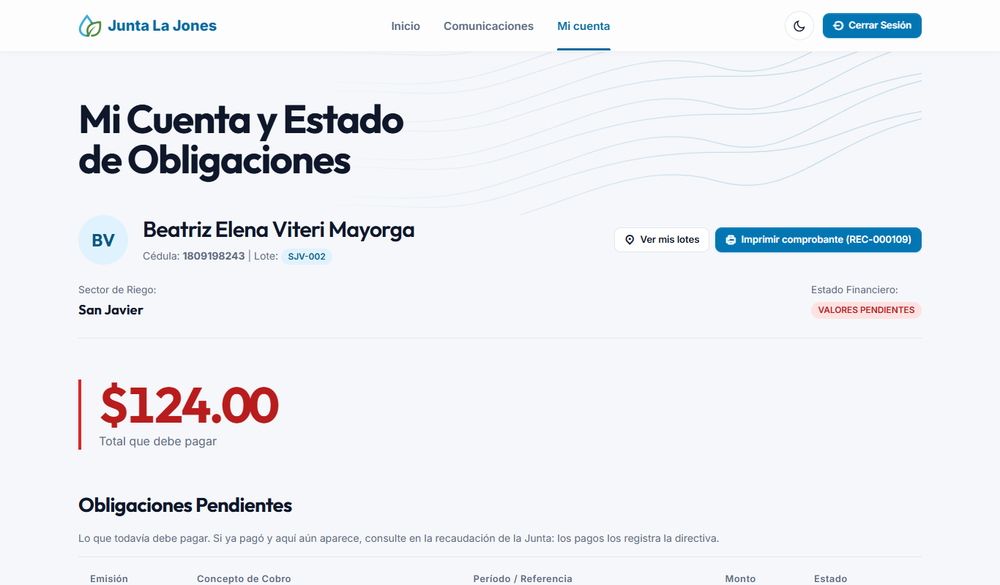

**Consideraciones:** los pagos se reciben **solo por transferencia bancaria**. La sección **Puntos de Pago Autorizados** muestra la cuenta de la Junta y dónde entregar el comprobante (la sede, los sábados de 08:00 a 12:00). La directiva registra el pago; si ya pagó y aún aparece pendiente, entregue o envíe el comprobante a la Junta.

### Ver mis lotes y turnos

1. En **Mi cuenta**, pulse **Ver mis lotes**.
2. Cada lote muestra su código, sector, ubicación en el mapa, superficie, referencia y sus **turnos de riego**.
3. **Ver en Google Maps** abre la ubicación en Google Maps.

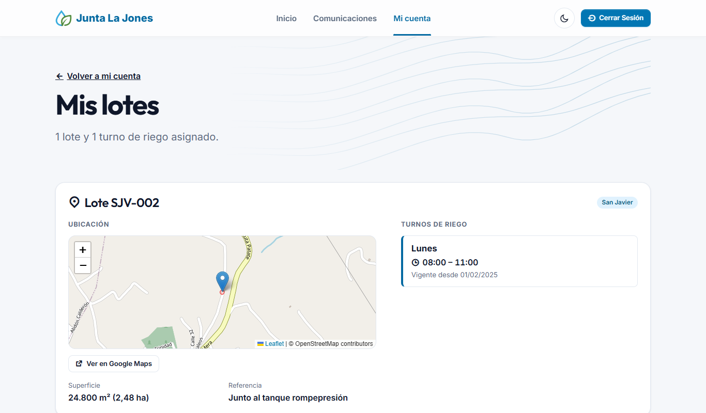

## 8. Instrucciones para la directiva (rol Administrador)

### 8.1 Resumen general

Muestra lo recaudado y lo pendiente, los egresos y el saldo de caja; **Acciones rápidas** (Registrar cobro, Registrar egreso, Registrar usuario, Asignar turno de agua, Convocar asamblea, Convocar minga); el resumen operativo y los próximos eventos.

### 8.2 Gestión de Usuarios: padrón

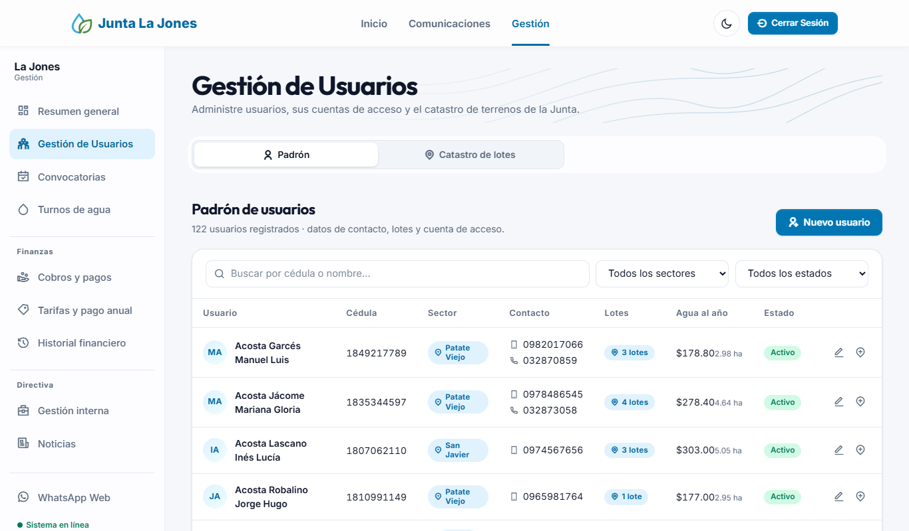

#### Buscar usuarios

Escriba cédula o nombre en el buscador; filtre por sector y por estado (**Activos**, **Inactivos**). **Limpiar filtros** quita los filtros. La columna **Agua al año** muestra las hectáreas y el valor anual según la tarifa vigente.

#### Registrar un usuario

**Objetivo:** agregar un socio o socia al padrón y, si se desea, darle acceso.

**Procedimiento:**

1. Vaya a **Gestión de Usuarios → Padrón** y pulse **Nuevo usuario**.
2. Complete **Cédula**, **Nombres** y **Apellidos** (obligatorios) y, si los tiene, fecha de nacimiento, celular, teléfono convencional, correo y dirección.
3. Para que pueda entrar al sistema, marque **Generar cuenta de acceso para este usuario** y elija el rol: **Usuario** (consulta su propia información) o **Administrador** (directiva, acceso total).
4. Pulse **Guardar**.

**Resultado:** el usuario aparece en el padrón. Si creó la cuenta, el sistema muestra **una sola vez** la contraseña temporal: entréguela a la persona en mano.

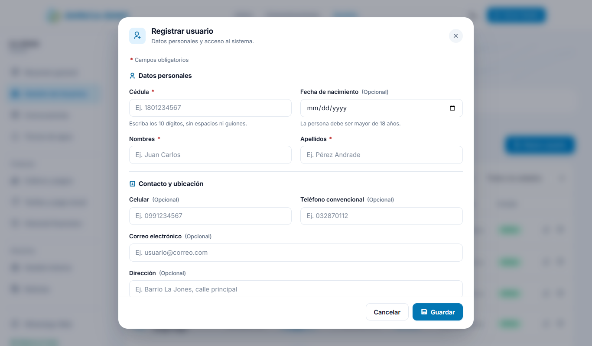

**Consideraciones:** la cédula debe ser ecuatoriana válida y no repetida; la persona debe ser mayor de 18 años si indica la fecha; el celular empieza con 09 y tiene 10 dígitos; el teléfono fijo tiene 9 dígitos (ej. 032870112).

#### Editar, inactivar, crear cuenta o restablecer la contraseña

1. En el padrón, pulse el ícono de editar del usuario.
2. Cambie los datos y el **Estado** (Activo o Inactivo).
3. En **Cuenta de acceso web** puede **Crear cuenta**, cambiar el rol o el estado de la cuenta, o **Restablecer contraseña** (genera una temporal nueva y cierra las sesiones abiertas de esa persona).
4. Pulse **Guardar**.

**Consideraciones:** no puede inactivarse ni cambiar su propia cuenta, ni dejar a la Junta sin administradores activos. Una persona con historial no se elimina: se inactiva.

#### Desbloquear una cuenta

Si alguien quedó bloqueado por intentos fallidos, el padrón muestra un aviso con las cuentas bloqueadas. Pulse **Desbloquear** junto a la persona: podrá entrar de inmediato sin cambiar su contraseña.

#### Asignar o transferir un terreno

1. En el padrón, abra los lotes del usuario y pulse **Asignar otro terreno**.
2. Busque el lote por código o sector y elija la relación (**Propietario titular** o **Representante**).
3. Pulse **Asignar lote** o, si ya tenía dueño, **Transferir lote**.

**Consideraciones:** cada lote tiene un solo titular. Al transferir, el sistema muestra antes la deuda de agua del lote: **las cuotas pendientes y los turnos activos pasan al nuevo titular**; lo ya pagado queda en el historial del anterior.

### 8.3 Gestión de Usuarios: catastro de lotes

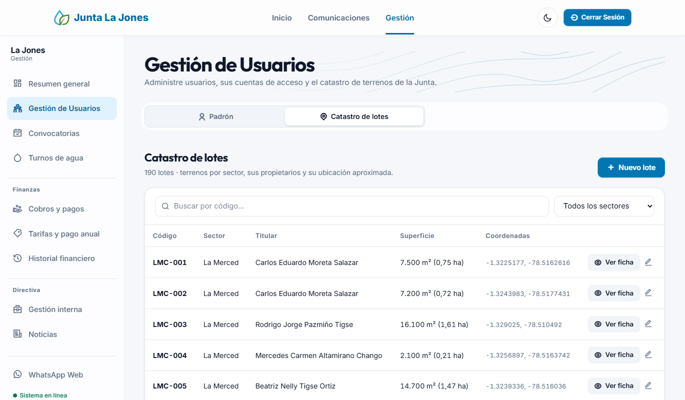

#### Registrar o editar un lote

1. Vaya a **Gestión de Usuarios → Catastro de lotes** y pulse **Nuevo lote** (o el ícono de editar).
2. Elija el **Sector**.
3. En **Código interno** pulse **Sugerir** o escriba uno con tres letras, guion y de tres a ocho dígitos (ej. `LJA-001`).
4. Escriba la **Superficie (m²)**; el sistema calcula las hectáreas.
5. Haga clic en el mapa para marcar la ubicación aproximada; puede indicar el margen de error, una referencia y observaciones.
6. Pulse **Guardar lote**.

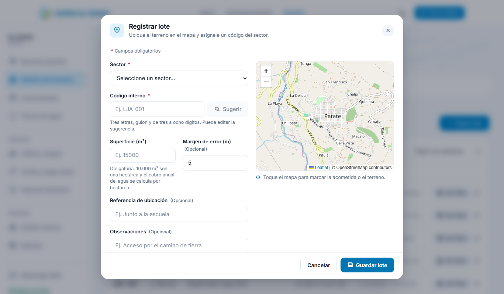

**Consideraciones:** la superficie es obligatoria porque el agua se cobra por hectárea. Si corrige la superficie de un lote con una cuota de agua pendiente, la cuota se recalcula; las ya pagadas no cambian. **Ver ficha** muestra el titular, la ubicación y la referencia.

### 8.4 Convocatorias: asambleas y mingas

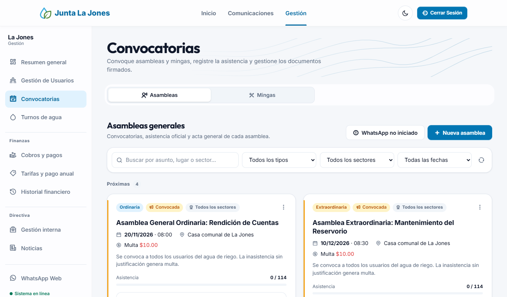

#### Crear una asamblea

1. Vaya a **Convocatorias → Asambleas** y pulse **Nueva asamblea**.
2. Elija el tipo: **Ordinaria** o **Extraordinaria**.
3. Complete **Título o asunto**, **Fecha de la sesión**, **Hora de inicio** y **Lugar**; opcionalmente el **Sector convocado** (sin sector se convoca a todos).
4. Agregue los puntos del orden del día con **Añadir punto**.
5. Deje marcada **Generar multa automática por inasistencia no justificada** si corresponde; el valor sale de la tarifa vigente.
6. Pulse **Guardar convocatoria**.

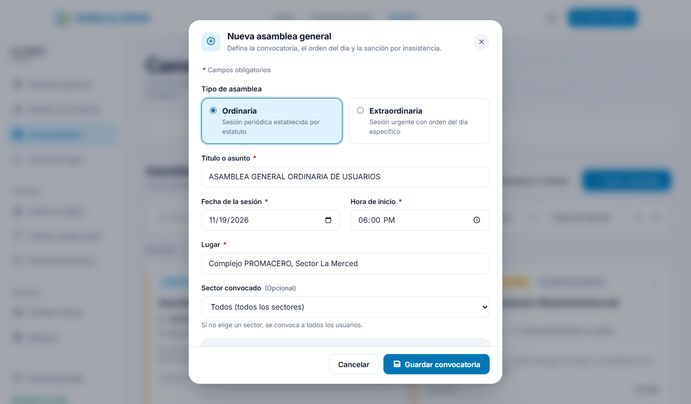

**Consideraciones:** la fecha no puede ser anterior a hoy.

#### Convocar

En la tarjeta de la asamblea:

- **Programar** y **Marcar convocada** cambian su estado.
- **Convocatoria en PDF** genera el documento para imprimir.
- **Convocar por WhatsApp** publica la convocatoria en el grupo de la Junta (requiere WhatsApp vinculado, sección 8.10). Solo se envía una vez por evento.

#### Registrar la asistencia

1. En la tarjeta, abra la asistencia.
2. Marque a cada persona como **Presente**, **Ausente** o **Justificado**; puede **Adjuntar archivo** como justificativo. **Todos presentes** y **Todos ausentes** marcan a todos.
3. Pulse **Guardar asistencia**.

#### Redactar el acta y subir los documentos firmados

1. Pulse **Acta**: registre por cada punto la deliberación y la resolución; con **Tema nuevo / punto extraordinario** agrega temas.
2. Pulse **Guardar acta** y **Generar PDF**.
3. En **Documentos firmados** use **Subir firmado** para la convocatoria, el acta y la lista de asistencia escaneadas (PDF, JPG o PNG, hasta 10 MB), y **Ver** para abrirlos.

#### Finalizar

**Finalizar** cierra la asamblea y **genera las multas** de quienes quedaron **Ausentes** (no a los justificados). Antes debe estar registrada la asistencia de todos y haber llegado la fecha y hora del evento. Si no se realizará, use **Cancelar asamblea**: no genera multas.

#### Mingas

**Convocatorias → Mingas** funciona igual: **Nueva minga** (actividad, trabajo a realizar, fecha, hora, lugar de encuentro, sector y si aplica multa), convocatoria, asistencia (**Marcar visibles presentes**), documentos, **Finalizar minga** o **Cancelar minga**.

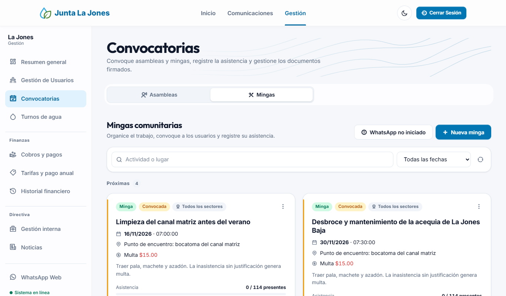

### 8.5 Turnos de agua

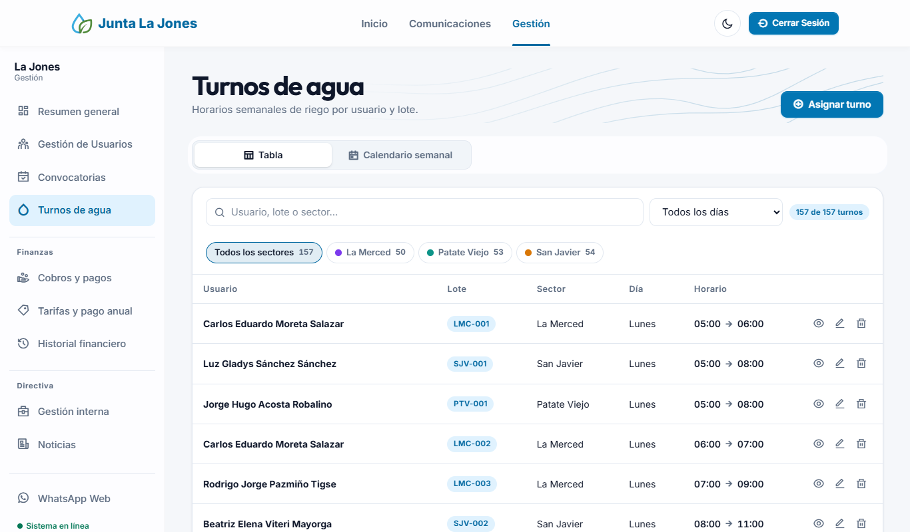

#### Asignar un turno

1. Vaya a **Turnos de agua** y pulse **Asignar turno**.
2. Busque y elija al **Usuario**; luego su **Lote beneficiario**.
3. Elija el **Día**, la hora de **Inicio** y de **Fin**, y observaciones si hace falta.
4. Pulse **Guardar turno**.

**Consideraciones:** el sistema rechaza un horario que se cruce con otro turno del mismo sector. Un turno que cruza la medianoche puede durar como máximo 12 horas. El usuario debe tener un lote.

#### Consultar, editar y eliminar

Use **Tabla** o **Calendario semanal**, filtre por sector, día o texto, y use los íconos para ver, editar o eliminar (pide confirmación).

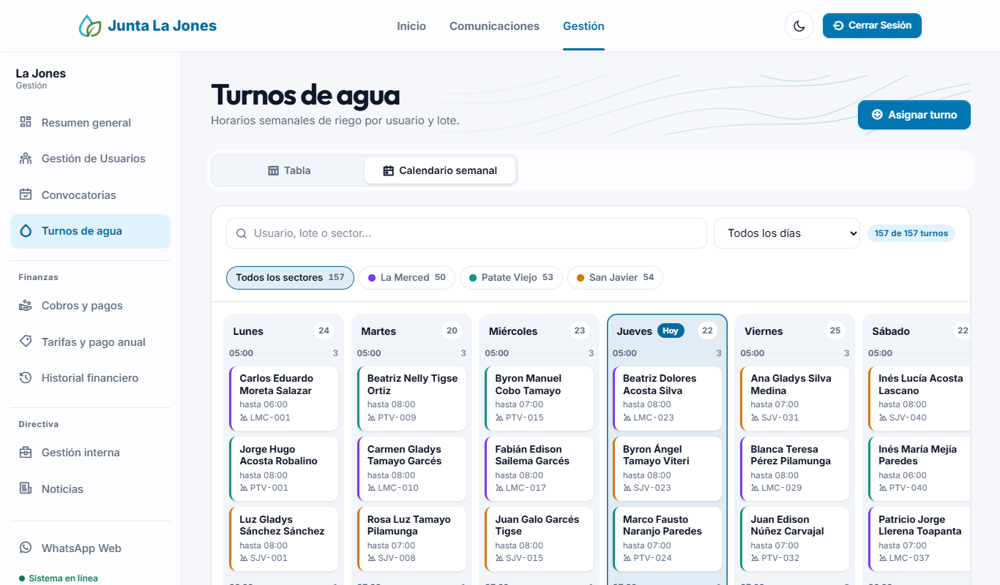

### 8.6 Finanzas: cobrar y registrar egresos

#### Cobrar a un usuario

**Objetivo:** registrar el pago del agua anual o de multas.

**Procedimiento:**

1. Vaya a **Cobros y pagos → Cobrar** (o **Registrar cobro** en el Resumen).
2. Busque al usuario por apellido, nombre o cédula (al menos 2 caracteres) y elíjalo.
3. Elija la pestaña **Agua anual** o **Multas y otros** y marque las obligaciones a pagar.
4. En **Caja**, elija la forma de pago (**Transferencia** o **Depósito**) y escriba el **Número de referencia** de la transacción; la observación es opcional.
5. Pulse **Registrar pago** y confirme.

**Resultado:** el recibo (`REC-…` o `REC-AGUA-…`) con **Descargar PDF**; puede **Seguir cobrando a este usuario** o **Cobrar a otro usuario**.

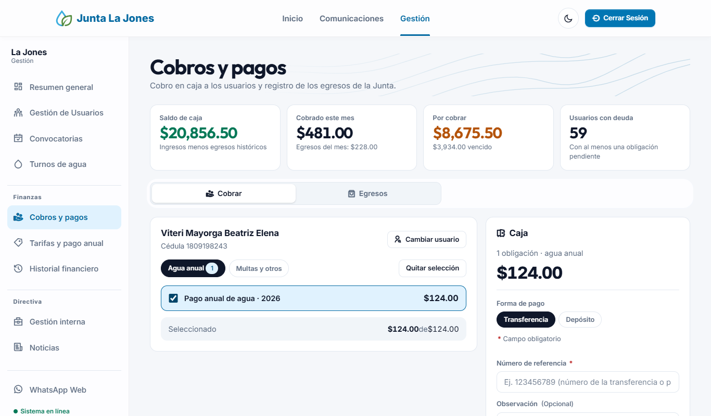

**Consideraciones:** la caja **no acepta efectivo**; cada pago necesita la referencia bancaria. Un pago equivocado se anula desde el historial (sección 8.8).

#### Registrar un egreso

1. Vaya a **Cobros y pagos → Egresos** y pulse **Registrar egreso**.
2. Complete **Fecha**, **Valor (USD)** y **Concepto**; opcionalmente proveedor, RUC o cédula, número de factura y descripción.
3. Pulse guardar.

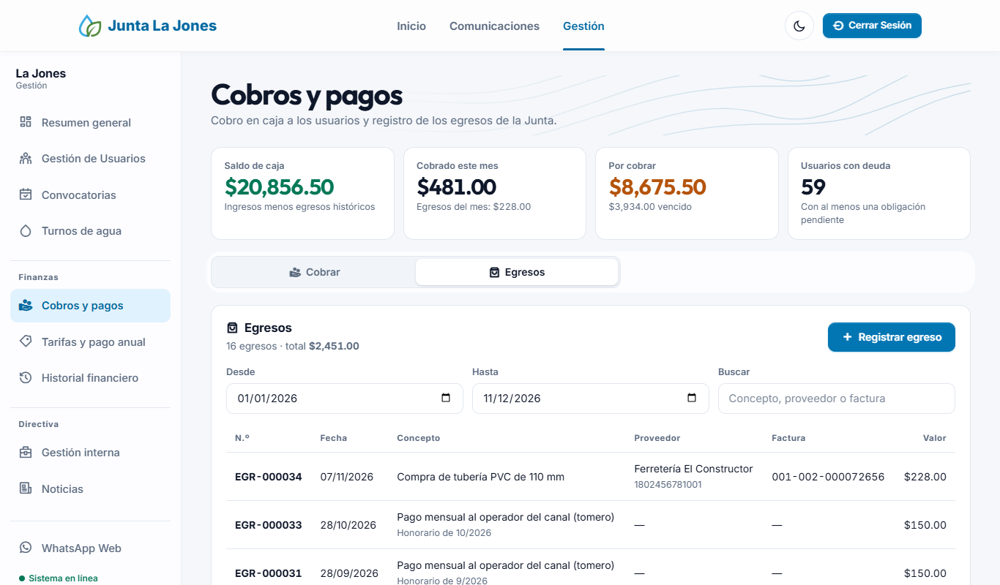

### 8.7 Finanzas: tarifas y pago anual de agua

#### Registrar o cambiar una tarifa

1. Vaya a **Tarifas y pago anual → Tarifas**.
2. Pulse **Nueva tarifa** o **Cambiar tarifa** en el concepto (pago anual de agua **por hectárea**, multa por inasistencia a asamblea, multa por inasistencia a minga).
3. Escriba el valor y la fecha desde la que rige; pulse guardar.

**Resultado:** la tarifa anterior se cierra el día previo; el historial queda en la tabla del concepto.

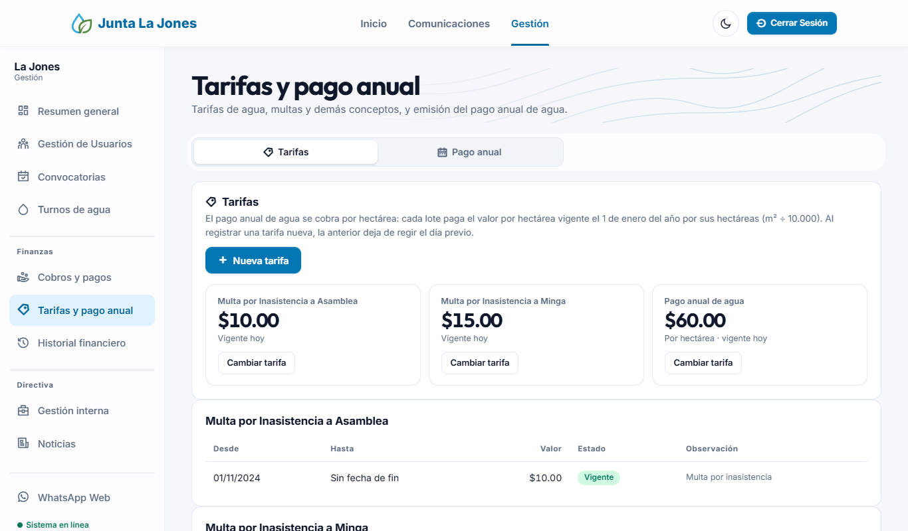

#### Emitir el pago anual de agua

1. Vaya a **Tarifas y pago anual → Pago anual** y elija el año.
2. Opcionalmente escriba un **Valor por hectárea**; si no, se usa la tarifa vigente al 1 de enero de ese año.
3. Revise la vista previa: cuántas obligaciones se emitirán, las hectáreas y el total.
4. Pulse emitir y confirme.

**Resultado:** cada lote activo con titular recibe su cuota del año (valor por hectárea × hectáreas del lote), con vencimiento el 31 de diciembre.

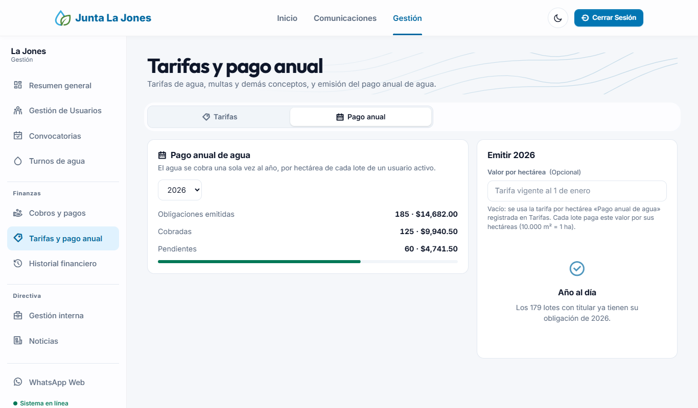

**Consideraciones:**

- Si algún lote no tiene superficie, no se emite nada y aparece la lista; pulse **Completar superficie** para corregirlos ahí mismo.
- Si aparece el aviso de lotes con **superficie provisional de demostración (1 ha)**, corríjalos en el catastro antes de emitir.
- Si no hay tarifa por hectárea vigente, regístrela en **Tarifas** o escriba el valor.
- Emitir es seguro de repetir: las cuotas ya emitidas de ese año se respetan.

### 8.8 Historial financiero

#### Recibos

En **Historial financiero → Recibos** filtre por fechas, estado (**Vigentes**, **Anulados**), tipo (**Pago anual de agua**, **Multas y otros**) y texto. En cada recibo puede:

- imprimirlo o descargarlo;
- **Subir comprobante bancario** (PDF, JPG o PNG, hasta 10 MB) de la transferencia o el depósito;
- **Anular pago** indicando el motivo: las obligaciones vuelven a quedar pendientes. Si el lote cambió de dueño, la cuota de agua reabierta pasa al titular actual.

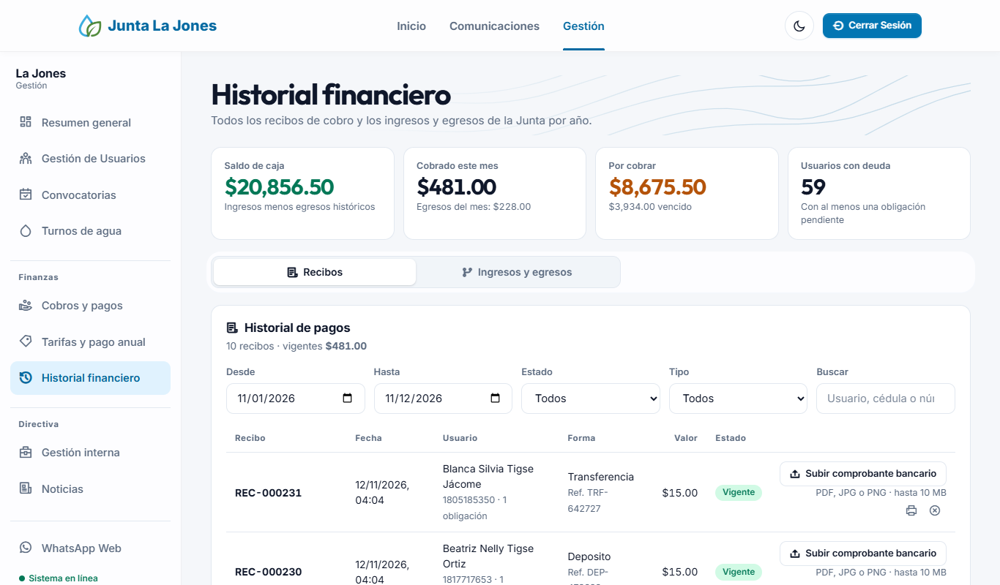

#### Ingresos y egresos

**Historial financiero → Ingresos y egresos** muestra, por año, los movimientos de la Junta.

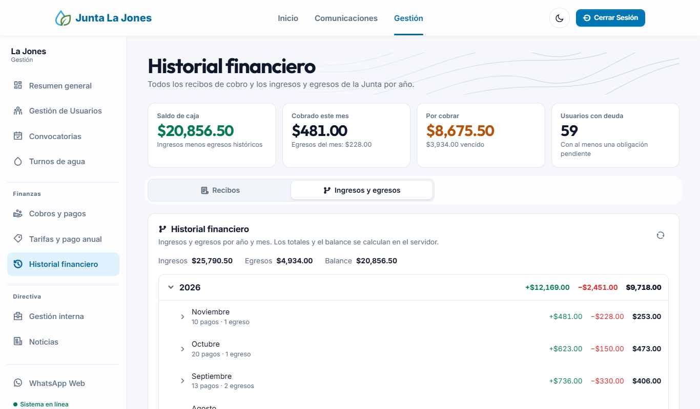

### 8.9 Gestión interna, noticias y seguridad de la cuenta

#### Auditoría

**Gestión interna → Auditoría** lista quién hizo cada cambio, cuándo, desde qué dirección y con qué detalle (cobros, anulaciones, altas, cambios de cuenta, inicios de sesión, alertas de seguridad). Filtre por **Desde**, **Hasta**, **Acción** y **Entidad**.

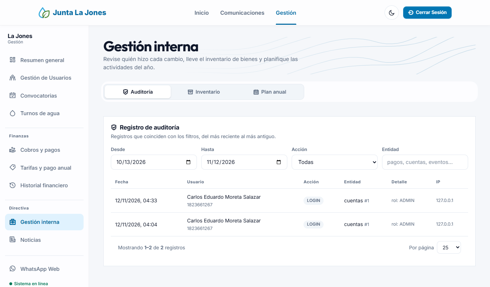

#### Inventario

**Gestión interna → Inventario**: **Registrar bien** (nombre, código, descripción, cantidad, valor, estado y ubicación) y **Editar**.

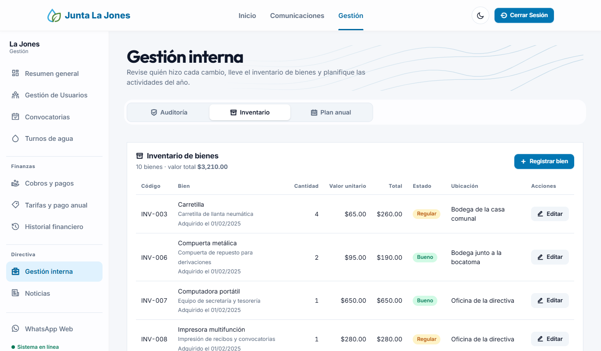

#### Plan anual

**Gestión interna → Plan anual**: **Nuevo plan** (año y descripción), **Actividad** para agregar actividades con fechas, y **Editar** para actualizar su estado.

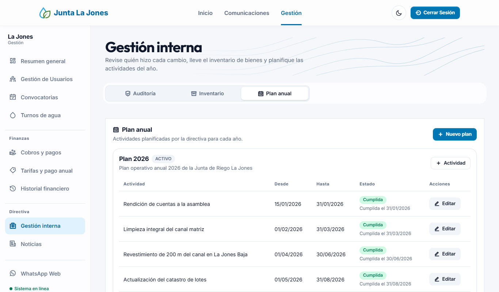

#### Noticias

**Noticias**: **Nueva noticia** (título, resumen, texto, imagen JPG o PNG y etiquetas), editar o eliminar (pide confirmación; no se puede deshacer). Las cinco más recientes aparecen en el carrusel del inicio.

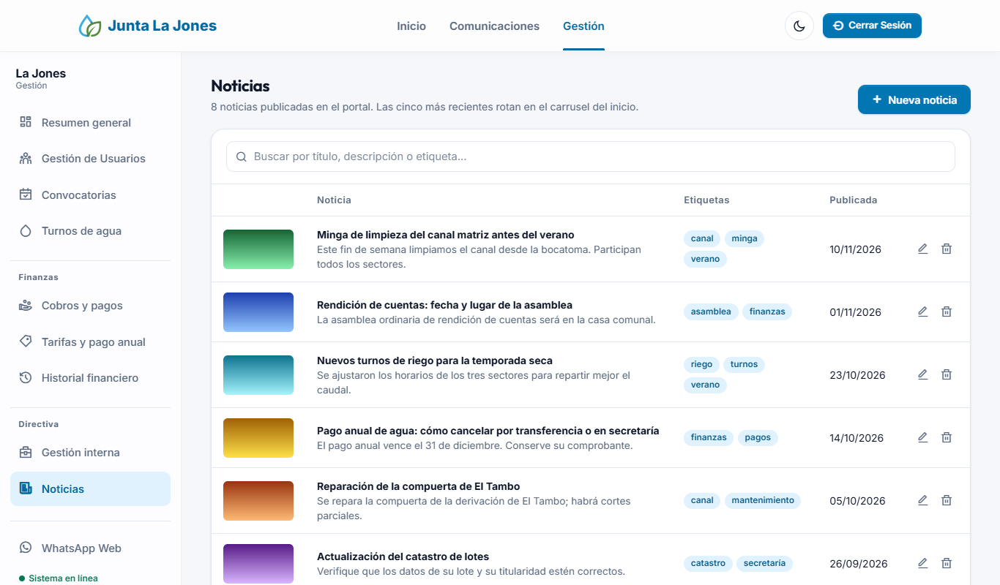

#### Verificación en dos pasos (recomendada para la directiva)

**Objetivo:** que nadie pueda entrar a su cuenta aunque conozca su contraseña.

**Procedimiento:**

1. Instale una aplicación de autenticación en su teléfono.
2. En el sistema, vaya a **Mi cuenta** y baje hasta **Verificación en dos pasos**. Pulse **Activar**.
3. En la aplicación, agregue una cuenta escaneando el código QR (o escriba la clave que aparece debajo).
4. Escriba el **Código de 6 dígitos** que muestra la aplicación y pulse **Confirmar**.
5. Guarde los **8 códigos de recuperación** en un lugar seguro (por ejemplo, impresos) y pulse **Ya los guardé**.

**Resultado:** desde ese momento, al ingresar se le pedirá el código.

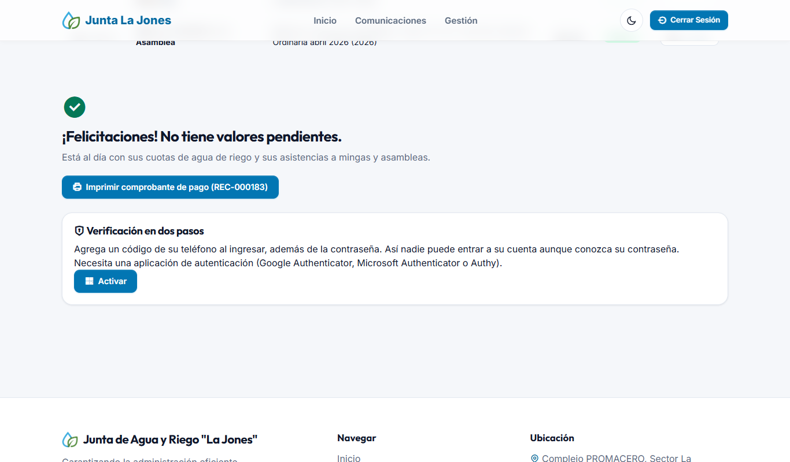

**Consideraciones:** para desactivarla, escriba su contraseña en **Contraseña actual para desactivarla** y pulse **Desactivar**. Si pierde el teléfono y los códigos, necesita ayuda técnica (sección 15).

### 8.10 WhatsApp Web

1. Pulse **WhatsApp Web** en el menú lateral.
2. Pulse **Conectar WhatsApp** y escanee el código QR con el teléfono de la Junta (WhatsApp → Dispositivos vinculados).
3. Elija el **Grupo de convocatorias** y pulse **Usar este grupo**.
4. **Desvincular** cierra la sesión de WhatsApp en el sistema.

Si el servicio de WhatsApp no está instalado o se detuvo, el panel lo indica y el resto del sistema sigue funcionando.

## 9. Formularios y validaciones

- Los campos obligatorios llevan un asterisco rojo (`*`); los opcionales dicen "(Opcional)".
- Si falta un dato o está mal escrito, el campo se marca y el sistema explica qué corregir antes de enviar. El servidor vuelve a validar todo.
- Principales reglas:

| Dato | Regla |
|---|---|
| Cédula | Ecuatoriana válida, 10 dígitos, no repetida |
| Contraseña | Mínimo 10 caracteres, letras y números, sin la cédula, no común |
| Celular | 10 dígitos, empieza con 09 |
| Teléfono fijo | 9 dígitos, ej. 032870112 |
| Edad | Mayor de 18 años si se indica la fecha de nacimiento |
| Código de lote | Tres letras, guion y de tres a ocho dígitos (`LJA-001`) |
| Superficie | Obligatoria, en m² |
| Importes | Mayores que cero, máximo dos decimales |
| Archivos | PDF, JPG o PNG, hasta 10 MB (imágenes de noticias: JPG o PNG) |
| Pagos | Solo Transferencia o Depósito, con número de referencia |

## 10. Mensajes del sistema

| Mensaje | Qué significa |
|---|---|
| "Credenciales incorrectas o la cuenta no está habilitada o se encuentra bloqueada temporalmente." | Cédula o contraseña incorrectas, cuenta inactiva o bloqueada por intentos |
| "La sesión expiró o no es válida. Inicie sesión nuevamente." | Pasaron más de 8 horas o se cerró la sesión desde otro equipo |
| "El código no es válido o ya se usó…" | Código de verificación incorrecto, vencido o repetido |
| "La solicitud no se pudo verificar. Recargue la página e intente de nuevo." | La página quedó desactualizada; recárguela |
| "No posee permisos suficientes para esta operación." | La acción es solo para la directiva |
| "Sin conexión" o "error del servidor" | Problema de red o del servidor; intente de nuevo con **Reintentar** |
| "No se puede generar el cobro anual porque existen lotes sin su superficie." | Complete la superficie de los lotes listados |

Las confirmaciones (por ejemplo, "Verificación en dos pasos activada.") aparecen en la esquina superior derecha. Las acciones que no se pueden deshacer (cancelar una asamblea, anular un pago, eliminar una noticia o un turno) piden confirmación antes.

## 11. Solución de problemas frecuentes

| Problema | Qué hacer |
|---|---|
| No puedo entrar y la contraseña es correcta | Espere 15 minutos o pida a la directiva que desbloquee la cuenta |
| Olvidé la contraseña | Acuda a la secretaría; la directiva le dará una temporal |
| El código de verificación no funciona | Revise que la hora del teléfono sea automática; use el código nuevo o un código de recuperación |
| Perdí el teléfono de la verificación | Use un código de recuperación; si no los tiene, pida ayuda técnica |
| Pagué y sigue apareciendo pendiente | La directiva debe registrar el pago; lleve el comprobante |
| El mapa no carga | Revise la conexión a internet |
| Una pantalla muestra **Reintentar** | Hubo un problema de conexión; pulse el botón |
| Tras una actualización me pide iniciar sesión | Es normal: ingrese otra vez |

## 12. Preguntas frecuentes

**¿Puedo pagar en efectivo?** No. Se paga por transferencia bancaria a la cuenta que aparece en Mi cuenta; la directiva registra el pago con el número de referencia.

**¿Cómo se calcula el pago anual de agua?** Valor por hectárea de la tarifa vigente × hectáreas de cada lote (m² ÷ 10.000), redondeado al centavo.

**¿Qué pasa si vendo mi lote?** Al transferirlo, las cuotas de agua pendientes del lote pasan al nuevo titular; lo ya pagado queda en su historial.

**¿Cuándo se genera una multa?** Al finalizar una asamblea o minga, a quien quedó **Ausente** sin justificación, si el evento genera multa.

**¿Puedo ver el acta de una asamblea?** Sí, en **Comunicaciones → Ver Acta Firmada**, con sesión iniciada.

**¿Por qué me cerró la sesión en todos mis equipos?** "Cerrar Sesión" cierra todas las sesiones de la cuenta, por seguridad.

## 13. Recomendaciones de uso

- No comparta su contraseña; en equipos compartidos, desmarque "Recordar mi sesión" y cierre la sesión al terminar.
- La directiva debe activar la verificación en dos pasos y mantener **al menos dos administradores** activos.
- Registre la superficie real de cada lote antes de emitir el pago anual.
- Revise la auditoría periódicamente, en especial las alertas de intentos de ingreso.
- Adjunte el comprobante bancario de cada pago para tener respaldo.

## 14. Glosario

| Término | Significado |
|---|---|
| Padrón | Lista de socios y socias de la Junta |
| Catastro | Registro de los lotes (terrenos) con su ubicación y superficie |
| Lote | Terreno con un código, un sector y un titular |
| Titular | Persona dueña (o representante) de un lote |
| Obligación | Valor que una persona debe pagar (cuota de agua o multa) |
| Pago anual de agua | Cuota del año por lote, calculada por hectárea |
| Minga | Trabajo comunitario convocado por la Junta |
| Asamblea ordinaria / extraordinaria | Sesión periódica / urgente con un orden del día específico |
| Recibo | Comprobante de un pago (`REC-…`, `REC-AGUA-…`) |
| Egreso | Gasto o pago que hace la Junta |
| Tarifa | Valor vigente de un concepto (agua por hectárea, multas) |
| Verificación en dos pasos | Código del teléfono que se pide además de la contraseña |
| Auditoría | Registro de quién hizo cada cambio y cuándo |

## 15. Limitaciones conocidas

- Algunas operaciones existen en el servidor pero aún **no tienen pantalla**: quitar la verificación en dos pasos de otra cuenta, eliminar un usuario registrado por error, crear sectores, anular un egreso y anular o crear una obligación manual. Requieren ayuda técnica (detalle en [`OBSERVACIONES.md`](OBSERVACIONES.md)).
- La recuperación de contraseña es presencial; no hay recuperación por correo.
- La convocatoria por WhatsApp usa WhatsApp Web (no oficial) y depende del teléfono de la Junta.
- Los mapas necesitan internet.
- La verificación en dos pasos solo está disponible para la directiva.
