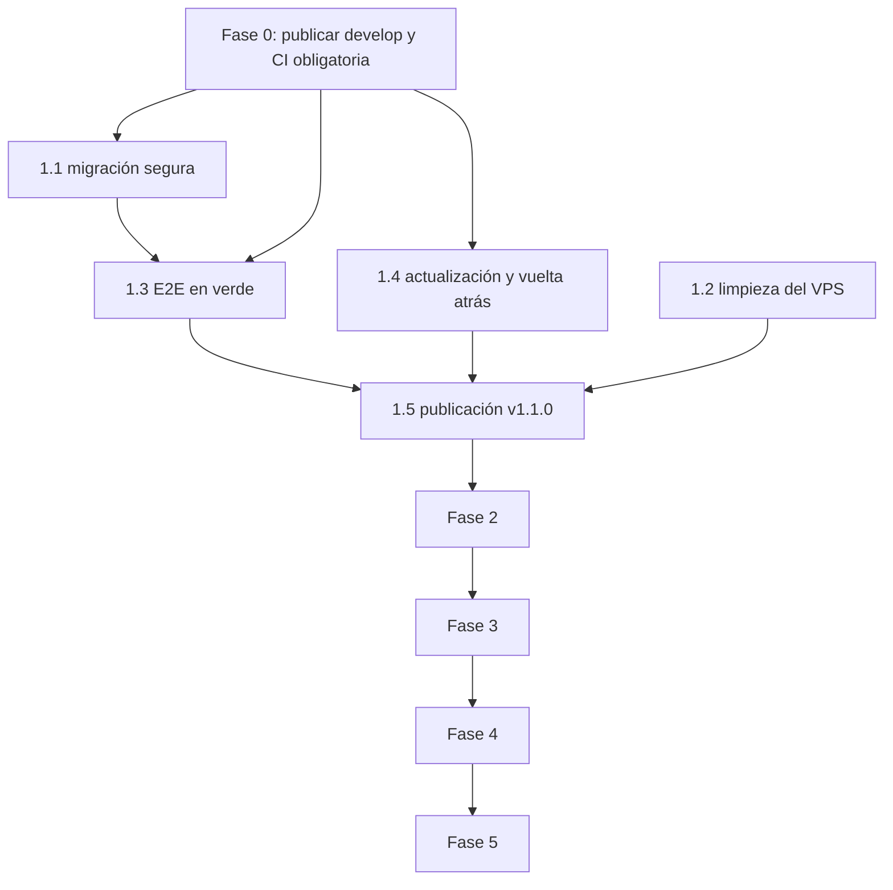

# Plan de implementación de las correcciones de la auditoría

Plan de trabajo para corregir los hallazgos de [`HALLAZGOS.md`](HALLAZGOS.md) siguiendo el orden de [`PLAN_CORRECCION.md`](PLAN_CORRECCION.md). Fecha: 2026-11-13. Base: `develop` `5439ceb`.

## Decisiones tomadas antes de planificar

| Pregunta | Decisión | Efecto en el plan |
|---|---|---|
| ¿El VPS tiene datos reales? | No: `v1.0.5` en el VPS tiene solo datos de prueba | La actualización no necesita conservar lotes ni cobros; se limpian antes de migrar |
| Lotes sin superficie y tarifa `AGUA_ANUAL` por lote | Eliminar los lotes actuales de la base del VPS | Fase 1.2: limpieza ordenada; la migración `031` deja de inventar superficies en producción |
| Respaldos automáticos externos (AP-02) | Servidor SSH propio y disco USB, pero se hacen después como módulo cotizado | Fuera de este plan: módulo 3.6 de la cotización de módulos pendientes (12 h). Aquí solo se usa el respaldo manual existente antes de cada cambio en el VPS |
| Alcance | P0 a P3, todo | Cinco fases; P0 primero |

## Reglas de trabajo

- Cada tarea en su rama desde `develop` (`feature/*`, `fix/*`, `refactor/*` o `chore/*`, según `CLAUDE.md`; las pruebas van con su cambio o como commit `test:`), commits pequeños en inglés con Conventional Commits y sin atribución de IA, integración con `git merge --no-ff`.
- Antes de cerrar cada rama: `npm run lint`, `npm test`, `npm --prefix frontend run build` y, si toca flujos de pantalla o de cobro, `E2E_CHANNEL=chrome npm run test:e2e`.
- Al cerrar cada fase: rama `docs/*` con la documentación (API, base de datos, operación, README) y actualización del estado de los hallazgos en `HALLAZGOS.md`. `CLAUDE.md` pide `docs/ROADMAP.md`, que hoy no existe: se crea en la fase 0 con estas fases como sprints.
- Nada se sube al VPS sin respaldo previo con `npm run respaldo` y confirmación explícita del responsable.

## Resumen

| Fase | Contenido | Hallazgos | Estimación |
|---|---|---|---|
| 0 | Preparación: publicar `develop`, CI obligatoria, ROADMAP | AP-26 (parcial) | 1 h |
| 1 | Bloqueadores (P0): cobro por hectárea seguro, limpieza del VPS, E2E en verde, actualización y vuelta atrás, publicación `v1.1.0` | AP-01, AP-03, AP-26 | 14 h |
| 2 | Alta prioridad (P1): tiempos límite y vigilancia | AP-04, AP-08 | 5 h |
| 3 | Prioridad media (P2): auditoría transaccional, acceso, WhatsApp, subtipo de asamblea | AP-05, AP-06, AP-07, AP-12, AP-19, AP-27 | 12 h |
| 4 | Mejoras (P3) | AP-09, AP-10, AP-13 a AP-18, AP-24, AP-25 | 11 h |
| 5 | Endurecimiento de sesión: TOTP para ADMIN y cookie `HttpOnly` (con ADR) | AP-06 (2FA), AP-11 | 12 h |
| Fuera | Respaldos automáticos externos | AP-02 | Cotización, módulo 3.6 |
| No requieren código | Decisiones o análisis | AP-20, AP-21, AP-22, AP-23 | — |

Las horas son estimaciones de desarrollo con pruebas; no incluyen esperas de revisión.

---

## Fase 0 — Preparación (1 h)

1. Publicar `develop` en `origin` (`git push origin develop`) para que CI corra sobre la versión candidata. Hoy `origin/develop` está en `8f8a65f`.
2. Activar en GitHub la protección de `main` y `develop`: exigir los trabajos "Backend", "Servicio de WhatsApp", "Frontend" y "E2E" en verde antes de integrar.
3. Rama `docs/roadmap`: crear `docs/ROADMAP.md` con las fases 1 a 5 como sprints y su tabla de seguimiento.

**Criterio de cierre:** CI corre en `develop`; su resultado (se espera rojo en E2E) queda como línea base.

---

## Fase 1 — Bloqueadores (P0), 14 h

### 1.1 `fix/migracion-hectarea-segura` (AP-01) — 4 h

Aunque los datos del VPS son de prueba, la migración debe ser segura para cualquier instalación futura con datos reales.

1. `031_lotes_superficie_provisional.js`: aplicar la superficie provisional solo si `process.env.NODE_ENV !== 'production'`; en producción solo agrega la nota a los lotes sin superficie. Commit `fix: keep lote superficie empty in production instead of a demo value`.
2. Nueva `033_cerrar_tarifa_agua_por_lote.js`: si existe una tarifa `AGUA_ANUAL` abierta y ninguna obligación anual tiene `valor_hectarea` (la tarifa nunca se usó por hectárea), cerrarla con `vigencia_hasta = UTC_DATE() - INTERVAL 1 DAY` y observación "Tarifa por lote cerrada al pasar al cobro por hectárea". En las bases de desarrollo sembradas con tarifas por hectárea no hace nada. Commit `fix: close the per-lote water tariff when moving to per-hectare billing`.
3. Aviso en Facturación anual y en el Resumen: número de lotes sin superficie o con la nota provisional, con enlace al catastro. Endpoint: agregar `lotesSinSuperficie` a `GET /api/financiero/agua-anual/resumen`. Commits `feat:` separados para API y pantalla.
4. Pruebas (`backend/test/integration/cobro-por-hectarea.test.js`): base en el estado de `v1.0.5` (lotes sin superficie, tarifa por lote, sin obligaciones por hectárea) → migrar con `NODE_ENV=production` → superficies `NULL`, tarifa cerrada, simulación del cobro responde 409. Y el caso de desarrollo: tarifa por hectárea intacta.

**Aceptación:** pruebas nuevas y existentes en verde; documentación de las migraciones en `docs/base_de_datos.md`.

### 1.2 Limpieza de los lotes de prueba del VPS (AP-01) — 1 h

Operación en el servidor, no en el repositorio. Borrar `lotes` directamente no es seguro: `turnos_riego.lote_id` es `ON DELETE SET NULL` (quedarían turnos sin lote) y las obligaciones anuales se borran en cascada pero sus pagos (`pago_anual_agua`) quedarían sin detalle. Orden propuesto, en una sola transacción, después de `npm run respaldo` y con el servicio detenido:

```sql
START TRANSACTION;
DELETE FROM pago_anual_agua;          -- borra su detalle en cascada
DELETE FROM obligacion_anual_agua;
DELETE FROM turnos_riego;
DELETE FROM persona_lotes;
DELETE FROM lotes;
-- comprobar conteos en 0 antes de confirmar
COMMIT;
```

Se ejecuta **antes** de desplegar la versión nueva, para que `031` no encuentre lotes. Los sectores, el padrón y las multas se conservan; si también son de prueba, se decide en ese momento si se recrea la base completa con `npm run prod:preparar` sobre una base vacía. Requiere confirmación explícita antes de ejecutarse.

**Aceptación:** conteos en 0, `/api/health` OK tras reiniciar, auditoría con un registro manual de la limpieza (fecha, quién, respaldo usado).

### 1.3 `fix/e2e-*` (AP-26) — 5 h

1. Ejecutar la E2E con trace (`npx playwright test --trace on`) y clasificar cada uno de los 7 fallos:

   | Prueba | Síntoma | Hipótesis inicial |
   |---|---|---|
   | `01-publico.spec.js:61` | Texto de la sede aparece 2 veces | Prueba desactualizada (`.first()` o ámbito de la sección) |
   | `03-sectores-y-lotes.spec.js:64` | Espera `1500 m²`, muestra `1.500 m² (0,15 ha)` | Prueba desactualizada por el formato en hectáreas |
   | `06-turnos.spec.js:14` | `Cannot read properties of undefined (reading 'cedula')` | Fallo encadenado: el estado compartido no se creó por el fallo anterior |
   | `09-finanzas.spec.js:138` | No aparece la vista previa del cobro anual | Por investigar: posible 409 por lotes sin superficie en los datos E2E o falta de tarifa por hectárea |
   | `10-mi-cuenta.spec.js:101` | No aparece "AL DÍA EN PAGOS" tras el cobro | Por investigar: puede quedar una cuota por hectárea pendiente |
   | `13-auditoria.spec.js:22` | La tabla de auditoría no tiene filas | Por investigar: filtro por defecto o encadenado |
   | `15-noticias.spec.js:337` | No aparece "8 noticias publicadas" | Por investigar: cambio en los datos sembrados |

   Además `04-asambleas.spec.js:219` está marcado como fallo esperado (AP-27, fase 3).
2. Regresiones reales: rama `fix/*` por cada una, con prueba de integración en el backend.
3. Pruebas desactualizadas: una rama `fix/e2e-actualizar-hectareas` con commits `test:` por archivo.
4. Dos ejecuciones completas seguidas en verde (local y CI).

**Aceptación:** 0 fallidas y 0 sin ejecutar en local y en CI sobre `develop`.

### 1.4 `feature/actualizacion-segura` (AP-03) — 3 h

1. `backend/src/db/migrator.js`: `SELECT GET_LOCK('junta_migraciones', 30)` al empezar y `RELEASE_LOCK` en `finally`; si no obtiene el bloqueo, falla con un mensaje claro. Prueba: dos `migrate()` en paralelo sobre la base de prueba aplican cada migración una sola vez.
2. `scripts/actualizar.js` y `npm run actualizar -- <etiqueta>`: comprueba que el árbol esté limpio, ejecuta `npm run respaldo` (si falla, se detiene), `git fetch --tags`, `git checkout <etiqueta>`, `npm run prod:preparar`, pide reiniciar el servicio (o lo hace con `systemctl` si se pasa `--reiniciar`), espera `/api/health` 200 durante 60 s y, si falla, imprime los comandos exactos de vuelta atrás con la etiqueta anterior y el respaldo recién creado.
3. `docs/operacion.md`: sección "Actualizar y volver atrás"; README: script nuevo en la tabla de scripts.

**Aceptación:** ensayo en una copia local con datos de `v1.0.5`: subir a la etiqueta nueva y volver a `v1.0.5` restaurando el respaldo.

### 1.5 Publicación `v1.1.0` — 1 h

1. Rama `docs/cierre-fase-1`: estado de AP-01, AP-03 y AP-26 en `HALLAZGOS.md`, ROADMAP, API y base de datos.
2. `develop` → `main` con `--no-ff`, CI verde, etiqueta `v1.1.0`.
3. En el VPS: tarea 1.2 → `npm run actualizar -- v1.1.0` → registrar la tarifa `AGUA_ANUAL` por hectárea → cargar lotes con superficie → simular el cobro anual.

**Aceptación de la fase:** las casillas de las secciones 1 a 5 de `CHECKLIST_PRODUCCION.md` marcadas en el VPS, excepto las de respaldo externo (módulo 3.6).

---

## Fase 2 — Alta prioridad (P1), 5 h

### 2.1 `fix/db-timeouts` (AP-04) — 2 h

- `config/db.js`: `queueLimit: 50`, `connectTimeout: 10000`; `config/env.js`: `DB_QUERY_TIMEOUT_MS` (por defecto 30000) aplicado como `timeout` en las consultas del pool.
- `app.js`: `/api/health` con `Promise.race` de 3 s → 503 `DATABASE: TIMEOUT`.
- `.env.production.example` y `docs/operacion.md` actualizados.
- Pruebas: unitaria de `/api/health` con una consulta que nunca responde; ensayo manual con `docker pause junta_las_jones_mysql`.

### 2.2 `feature/vigilancia-disco-errores` (AP-08) — 3 h

- `scripts/vigilar.js`: espacio libre con `fs.statfs` de la carpeta de datos, `uploads/` y `backups/` (`VIGILAR_DISCO_MIN_GB`, por defecto 2); aviso si `/api/health` tarda más de 2 s.
- Errores 5xx: contador en memoria en `requestLogger` expuesto en `/api/health` solo para `127.0.0.1` (`errores5xxUltimaHora`), y aviso del vigilante si supera un umbral.
- `deploy/junta-vigilante.service.example` como archivo propio (hoy está comentado dentro del del backend).
- Pruebas unitarias de los umbrales.

---

## Fase 3 — Prioridad media (P2), 12 h

### 3.1 `refactor/auditoria-transaccional` (AP-05) — 3 h

Pasar `conexion` (o usar `conAuditoria`) en: finalizar evento y minga, registrar asistencias, crear y actualizar lote, transferir titularidad, cambiar estado de evento. Prueba de integración: si el `INSERT` en `auditoria` falla (tabla renombrada en la base de prueba), finalizar un evento no genera multas.

### 3.2 `fix/bloqueo-inicio-sesion` (AP-06 parcial, AP-12) — 3 h

- Migración: columna `primer_fallo_en` en `intentos_login`; los intentos se reinician si el primero es anterior a 15 min.
- Límite global por cuenta (todas las IP): a partir de 20 fallos en 1 h, retraso progresivo y aviso en el banner de cuentas bloqueadas del padrón.
- Purga de filas con `updated_at` de más de 30 días al iniciar el servidor y una vez al día.
- Pruebas con `TRUST_PROXY=1` y `X-Forwarded-For` variable.

### 3.3 `chore/whatsapp-servicio` (AP-07, AP-19) — 2 h

- `deploy/junta-whatsapp.service.example` con `Restart=always` y `Environment=PUPPETEER_SKIP_DOWNLOAD=true`.
- ADR `docs/architecture/adr/` "Riesgo aceptado de whatsapp-web.js" con los avisos de `npm audit`, la mitigación (`127.0.0.1`, token) y fecha de revisión.

### 3.4 `feature/subtipo-asamblea` (AP-27) — 4 h

- Migración `subtipo ENUM('ORDINARIA','EXTRAORDINARIA') NULL` en `eventos`, rellenada desde el título para las asambleas existentes.
- Guardar el subtipo al crear y editar; filtrar por la columna en `listarEventosPasados`.
- Quitar `test.fail` de `e2e/tests/04-asambleas.spec.js:222`; prueba de integración del filtro.

---

## Fase 4 — Mejoras (P3), 11 h

| Rama | Hallazgo | Cambio | Prueba | Horas |
|---|---|---|---|---|
| `fix/lote-update-lock` | AP-09 | Leer el lote con `FOR UPDATE` dentro de la transacción | Dos `PUT` concurrentes | 1 |
| `fix/anular-pago-anual-titular` | AP-10 | Al anular, la cuota vuelve al titular actual del lote | Transferir, anular pago anterior, verificar titular | 1,5 |
| `docs/usuario-bd-minimo` | AP-13 | Usuario de migración con DDL y de ejecución sin DDL en `docs/operacion.md` | Ensayo en el VPS | 0,5 |
| `chore/dependabot` | AP-14 | Integrar las PR de Dependabot pendientes (Angular 22.2.6 y menores) | CI verde, `npm audit` sin altos | 1,5 |
| `chore/cobertura` | AP-15 | `@vitest/coverage-v8`, cobertura en CI, pruebas de `DELETE /api/personas/:id` | CI publica cobertura | 2 |
| — | AP-16 | Consultar en el VPS la cédula de ejemplo `1800000001` (se resuelve con la limpieza si es de prueba) | Consulta | 0 |
| `refactor/indice-auditoria` | AP-17 | Índice `(fecha, id)` en `auditoria` | `EXPLAIN` sin `filesort` | 0,5 |
| `fix/revocacion-reloj` | AP-18 | Marcas de revocación con la hora de Node | Unitaria con reloj desfasado | 1 |
| `chore/build-commonjs` | AP-24 | `allowedCommonJsDependencies` o variantes ESM | Build sin avisos | 0,5 |
| `refactor/hash-asincrono` | AP-25 | `bcrypt` nativo o `crypto.scrypt`, rehash transparente al iniciar sesión | Compatibilidad de hashes; 50 ingresos en paralelo | 2,5 |

---

## Fase 5 — Endurecimiento de sesión (12 h)

Cambia cómo inician sesión los administradores, así que va con un ADR propio y aviso a la directiva.

1. **TOTP para ADMIN (AP-06):** activación desde "Mi cuenta" con QR, códigos de recuperación de un solo uso, verificación en el login con un token intermedio (como el de cambio de contraseña), desactivación por otro administrador o por `npm run db:reset-admin`. Primero opcional, luego obligatorio para ADMIN. 7 h.
2. **Cookie `HttpOnly` (AP-11):** el token pasa a cookie `HttpOnly; Secure; SameSite=Strict` con protección CSRF por doble envío; el frontend deja de guardar el token. Convivencia temporal con `Authorization` para no cerrar sesiones abiertas. 5 h.

---

## Hallazgos sin cambios de código

| ID | Tratamiento |
|---|---|
| AP-02 | Módulo 3.6 de la cotización (respaldos automáticos con copia a servidor SSH propio y disco USB). Mientras tanto, respaldo manual antes de cada cambio en el VPS |
| AP-20 | Se mantiene: una sola instancia. Revisar si algún día se escala |
| AP-21 | Se mantiene: necesario para Angular y Leaflet |
| AP-22 | Se mantiene; la fase 1.5 exige dos administradores activos |
| AP-23 | Revisión legal de la LOPDP por la Junta, fuera del alcance técnico |

## Orden y dependencias



1.1 va antes de 1.3 porque cambia el comportamiento de la facturación y puede cambiar el resultado de las E2E. Las fases 2 a 4 son independientes entre sí por tarea y se pueden reordenar; la 5 va al final porque cambia el inicio de sesión.
